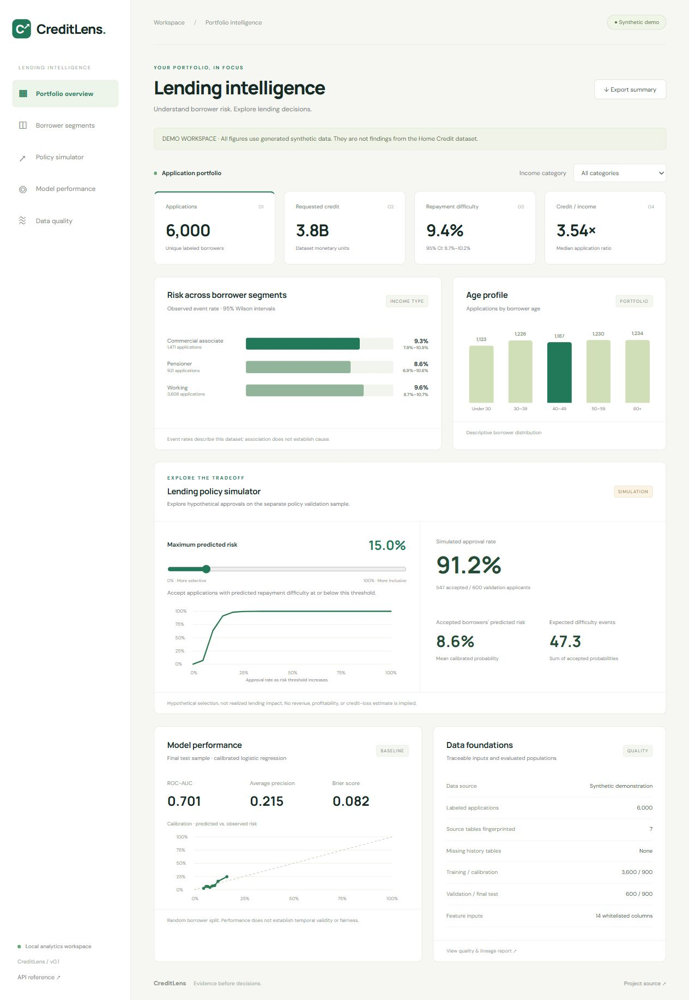

# CreditLens

[](https://github.com/jayyy255/creditlens/actions/workflows/ci.yml)

Credit risk and lending intelligence using the Home Credit Default Risk relational dataset.

## Project status

The repository is being built incrementally. A working local baseline generates synthetic relational data, validates source files, creates analytical features, evaluates a calibrated logistic regression, and serves an interactive analytics dashboard. No real Home Credit results or production-ready model are claimed.

## Run the demo

Requires Python 3.11 or newer. From the repository root:

```sh
python -m venv .venv
# Windows: .venv\Scripts\Activate.ps1
# macOS/Linux: source .venv/bin/activate
python -m pip install -e ".[dev]"
python -m creditlens.cli demo
python -m uvicorn creditlens.api:app --host 127.0.0.1 --port 8000
# In a second terminal:
python -m pytest
```

Open [the local dashboard](http://127.0.0.1:8000) or [API documentation](http://127.0.0.1:8000/docs). Filter income categories, compare segment event rates, move the policy risk slider, inspect calibration, and export a portfolio summary.



The demo produces 6,000 deterministic synthetic applications and six historical tables. Derived CSVs live in `data/silver/` and `data/gold/`; quality and source-hash reports are in `data/quality.json`. Model metrics, split membership, validation scores, and the trusted local model artifact are in `artifacts/`. All generated data and model files are ignored by Git.

For Home Credit data, run `python -m creditlens.cli ingest --source data/raw` followed by `python -m creditlens.cli train`. Include `application_test.csv` when providing full historical tables so foreign-key checks recognize unlabeled borrowers. Each history table is optional; absent histories are disclosed in the quality report.

## Model protocol

A borrower appears in exactly one partition: training 60%, sigmoid calibration 15%, policy validation 10%, final test 15%. Preprocessing is fitted on training rows. Only whitelisted financial and historical features enter the model. Gender and age are retained for diagnostics, not direct model inputs. Reports include ROC-AUC, average precision, Brier score, calibration bins, a constant-risk baseline, exploratory subgroup metrics, and a validation ROC-AUC bootstrap interval. Random borrower splits cannot establish temporal generalization; demographic omission cannot establish fairness.

## Intended architecture

CSV sources → Bronze / Silver / Gold pipeline → analytical warehouse → statistics and risk models → FastAPI → interactive dashboard and Power BI.

## Delivery milestones

- [x] Repository foundation and project brief.
- [x] Reproducible synthetic demo and validated ingestion.
- [x] Leakage-aware baseline evaluation and policy simulation engine.
- [x] Analytics API and interactive dashboard.
- [x] Optional PostgreSQL mart and advanced analytics SQL (execution unverified locally).
- [x] Power BI connection guide and DAX starter measures; CI and operating documentation.
- [ ] Full Home Credit run, PostgreSQL/container validation, completed Power BI report, and deployed production services.

## Documentation

- [Data and model methodology](docs/methodology.md)
- [Local operation, containers, warehouse loading, and production backlog](docs/operations.md)
- [Power BI integration](docs/power-bi.md)
- [Advanced SQL analyses](warehouse/analyses.sql)

The current web interface is a lightweight static frontend served by FastAPI. Next.js, dbt, Prefect, Redis, SHAP, advanced models, and monitoring are planned extensions, not implemented capabilities. Local verification: 11 automated tests passed; browser filtering and 0%/100% policy boundaries checked. CI additionally checks repeat PostgreSQL loading, mart totals, policy sums, and analytical SQL execution.

## Interpretation

The Home Credit target represents the dataset's defined repayment-difficulty outcome. It is not a universal measure of banking default or loss. Lending thresholds produce hypothetical simulations; revenue, profitability, and realized policy impact are not established by these data.

## Data

Obtain Home Credit data under its applicable terms and place CSV files in `data/raw/`. Raw data, derived data, and trained model artifacts are excluded from Git. A synthetic demo will support development without the restricted dataset.

See [the project brief](docs/project-brief.md) for the requested scope.
