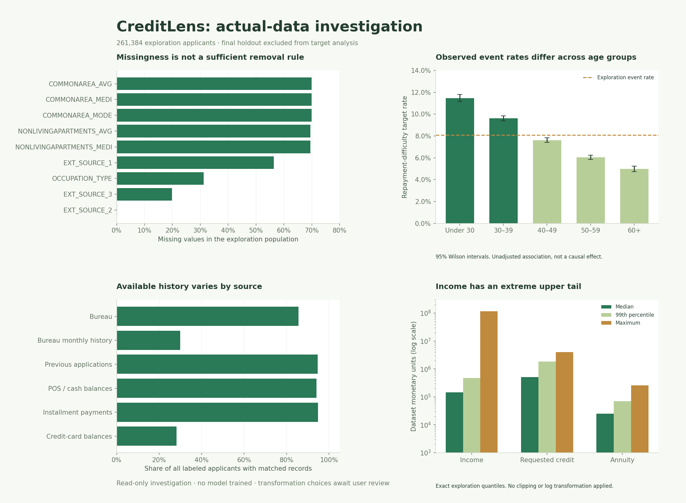

# CreditLens: seven-stage dataset investigation

Date: 14 October 2026. Source: the supplied Home Credit CSV files in `data/`, interpreted with the supplied column-description CSV. All observations below are computed from those local files. This is an investigation, not an applied cleaning policy or model comparison.

**Population:** 307,511 labeled applications and 48,744 unlabeled applications. A fixed, stratified final holdout of **46,127 borrowers** is reserved locally. Target relationships use only the **261,384 exploration borrowers**, including 21,101 target events (8.07%). Row counts, structural checks and historical scans cover full source tables. Application distributions and correlations use the exploration population unless stated otherwise.

The holdout is not yet wired into the existing demo training command. Before real-data modeling, that command must be changed to reuse `artifacts/eda/partition.csv` rather than creating a fresh final test split. No target-based final-holdout diagnostics or model evaluation were performed in this investigation.

## 1. Data integrity and relationships

| Table | Rows | Columns | Investigated grain | Labeled borrower coverage |
| --- | --- | --- | --- | --- |
| application_train | 307,511 | 122 | Labeled application | 100% |
| application_test | 48,744 | 121 | Unlabeled application | n.a. |
| bureau | 1,716,428 | 17 | SK_ID_BUREAU | 85.69% |
| bureau_balance | 27,299,925 | 3 | SK_ID_BUREAU, MONTHS_BALANCE | 29.99% |
| previous_application | 1,670,214 | 37 | SK_ID_PREV | 94.65% |
| POS_CASH_balance | 10,001,358 | 8 | SK_ID_PREV, MONTHS_BALANCE | 94.12% |
| installments_payments | 13,605,401 | 8 | SK_ID_PREV, NUM_INSTALMENT_VERSION, NUM_INSTALMENT_NUMBER | 94.84% |
| credit_card_balance | 3,840,312 | 23 | SK_ID_PREV, MONTHS_BALANCE | 28.26% |

Application IDs: 0 repeated training IDs; 0 repeated test IDs; 0 IDs shared between training and unlabeled test. Full-row duplicates: training 0, unlabeled test 0. Schema difference: TARGET.

| History | Orphan borrower rows | Unmatched parent rows | Parent/borrower mismatch | Repeated row-hash extras | Repeated grain extras |
| --- | --- | --- | --- | --- | --- |
| bureau | 0 | 0 | 0 | 0 | 0 |
| bureau_balance | 3,120,184 | 3,120,184 | 0 | 0 | 0 |
| previous_application | 0 | 0 | 0 | 0 | 0 |
| POS_CASH_balance | 0 | 340,561 | 0 | 0 | 0 |
| installments_payments | 0 | 1,250,826 | 0 | 0 | 653,483 |
| credit_card_balance | 0 | 1,082,816 | 0 | 0 | 0 |

History duplicate diagnostics use 64-bit pandas hashes across all chunks. They identify candidates, not a deletion rule; collisions are possible and grain repetitions can be legitimate observations. For installments, the candidate grain excludes individual payment transactions, so repeated schedule keys must not automatically be removed. Missing history means no matched records in this dataset, not proof of no prior borrowing.

**Important join finding:** 3,120,184 bureau-month rows cannot be mapped to the supplied bureau table. Their borrower is consequently unknown, not a directly observed invalid borrower ID. Other child tables contain valid direct borrower IDs even where their previous-contract ID is absent from previous_application. These are incomplete cross-table links, not automatically corrupt payment records. The current demo ingestion command rejects unmatched bureau parents and would fail on these actual source files; that policy needs an approved revision before a real-data run.

**Decision 1:** recommendation: keep all source rows in raw storage, report incomplete parent links separately, retain directly borrower-linked child records for eligible aggregation, and quarantine unmappable bureau-month records from borrower features. Do not blanket-deduplicate or use inner joins that silently discard unmatched history. Cause of missing parent coverage is not established by these files.

## 2. Missing-value investigation

Predictor columns with exploration missingness above 30%: **50**.

Predictor columns with exploration missingness above 50%: **41**.

Predictor columns with exploration missingness above 70%: **0**.

| Column | Exploration missing | Unlabeled test missing | Unique non-null values |
| --- | --- | --- | --- |
| COMMONAREA_AVG | 69.91% | 68.72% | 3,086 |
| COMMONAREA_MEDI | 69.91% | 68.72% | 3,102 |
| COMMONAREA_MODE | 69.91% | 68.72% | 3,029 |
| NONLIVINGAPARTMENTS_AVG | 69.46% | 68.41% | 363 |
| NONLIVINGAPARTMENTS_MEDI | 69.46% | 68.41% | 203 |
| NONLIVINGAPARTMENTS_MODE | 69.46% | 68.41% | 161 |
| FONDKAPREMONT_MODE | 68.41% | 67.28% | 4 |
| LIVINGAPARTMENTS_AVG | 68.40% | 67.25% | 1,820 |
| LIVINGAPARTMENTS_MEDI | 68.40% | 67.25% | 1,087 |
| LIVINGAPARTMENTS_MODE | 68.40% | 67.25% | 731 |
| FLOORSMIN_AVG | 67.86% | 66.61% | 295 |
| FLOORSMIN_MEDI | 67.86% | 66.61% | 47 |
| FLOORSMIN_MODE | 67.86% | 66.61% | 25 |
| YEARS_BUILD_AVG | 66.54% | 65.28% | 149 |
| YEARS_BUILD_MEDI | 66.54% | 65.28% | 151 |
| YEARS_BUILD_MODE | 66.54% | 65.28% | 154 |
| OWN_CAR_AGE | 65.98% | 66.29% | 62 |
| LANDAREA_AVG | 59.39% | 57.96% | 3,471 |
| LANDAREA_MEDI | 59.39% | 57.96% | 3,493 |
| LANDAREA_MODE | 59.39% | 57.96% | 3,502 |

| Important column | Missing | Observed target rate if missing | Observed target rate if present |
| --- | --- | --- | --- |
| OWN_CAR_AGE | 65.98% | 8.51% | 7.22% |
| EXT_SOURCE_1 | 56.35% | 8.50% | 7.52% |
| OCCUPATION_TYPE | 31.27% | 6.48% | 8.80% |
| EXT_SOURCE_3 | 19.82% | 9.39% | 7.75% |
| EXT_SOURCE_2 | 0.21% | 8.12% | 8.07% |
| AMT_ANNUITY | 0.00% | 0.00% | 8.07% |

Differences between missing/present groups are unadjusted associations. They do not prove that missingness causes repayment difficulty or that imputation will improve a model. Missing-not-at-random mechanisms cannot be established from this table alone.

| Owns car | Exploration borrowers | Missing car age | Missing share |
| --- | --- | --- | --- |
| N | 172,445 | 172,445 | 100.00% |
| Y | 88,939 | 5 | 0.01% |

Car-age missingness should therefore be interpreted alongside car ownership instead of filling every missing age with a general median.

**Decision 2:** options are semantic imputation plus indicators, native missing-value handling for supported tree models, or removal of selected sparse features. Recommendation: retain useful external-score features despite missingness; treat housing-feature families as a group for a later ablation. Do not automatically drop every column above a fixed missingness percentage. Training-only imputation must be fitted later, after the user selects an approach.

## 3. Sentinels, dates and unusual values

| Application date column | 365243 sentinel count | Positive including sentinel | Minimum | Maximum |
| --- | --- | --- | --- | --- |
| DAYS_BIRTH | 0 | 0 | -25,229 | -7,489 |
| DAYS_EMPLOYED | 46,881 | 46,881 | -17,583 | 365,243 |
| DAYS_ID_PUBLISH | 0 | 0 | -7,197 | 0 |
| DAYS_LAST_PHONE_CHANGE | 0 | 0 | -4,185 | 0 |
| DAYS_REGISTRATION | 0 | 0 | -23,738 | 0 |

| Application check | Exploration rows |
| --- | --- |
| income_nonpositive | 0 |
| credit_nonpositive | 0 |
| annuity_nonpositive | 0 |
| age_under_18_or_over_100 | 0 |
| employment_longer_than_age | 0 |
| employment_exceeds_age_minus_14 | 0 |
| children_exceed_family_size | 0 |
| family_size_zero | 0 |

| Income category | Employment sentinel present | Sentinel absent |
| --- | --- | --- |
| Businessman | 0 | 10 |
| Commercial associate | 0 | 60,885 |
| Maternity leave | 0 | 5 |
| Pensioner | 46,862 | 8 |
| State servant | 0 | 18,419 |
| Student | 0 | 13 |
| Unemployed | 19 | 0 |
| Working | 0 | 135,163 |

| History | Date field | Condition | Rows |
| --- | --- | --- | --- |
| bureau | DAYS_CREDIT_ENDDATE | Positive, excluding sentinel | 602,603 |
| bureau | DAYS_CREDIT_UPDATE | Positive, excluding sentinel | 17 |
| previous_application | DAYS_FIRST_DRAWING | 365243 | 934,444 |
| previous_application | DAYS_FIRST_DUE | 365243 | 40,645 |
| previous_application | DAYS_LAST_DUE_1ST_VERSION | 365243 | 93,864 |
| previous_application | DAYS_LAST_DUE | 365243 | 211,221 |
| previous_application | DAYS_TERMINATION | 365243 | 225,913 |
| previous_application | DAYS_LAST_DUE_1ST_VERSION | Positive, excluding sentinel | 224,392 |

| History | Amount field | Negative rows | Minimum |
| --- | --- | --- | --- |
| bureau | AMT_CREDIT_SUM_DEBT | 8,418 | -4,705,600 |
| bureau | AMT_CREDIT_SUM_LIMIT | 351 | -586,406 |
| previous_application | AMT_DOWN_PAYMENT | 2 | -0.9 |
| credit_card_balance | AMT_BALANCE | 2,345 | -420,250 |
| credit_card_balance | AMT_DRAWINGS_ATM_CURRENT | 1 | -6,827 |
| credit_card_balance | AMT_DRAWINGS_CURRENT | 3 | -6,212 |
| credit_card_balance | AMT_RECEIVABLE_PRINCIPAL | 2,428 | -423,306 |
| credit_card_balance | AMT_RECIVABLE | 109,338 | -420,250 |
| credit_card_balance | AMT_TOTAL_RECEIVABLE | 109,330 | -420,250 |

Positive **scheduled** credit end dates can legitimately be known at application time. Positive actual-payment, actual-end, update, or termination dates need a separate availability review. Future scheduled dates are not inherently leakage, but actual outcomes observed after the application would be. Negative account balances or payments may reflect credits/reversals and require semantic review rather than automatic deletion.

**Decision 3:** recommendation: make a field-specific sentinel and date-availability map. Convert the employment sentinel to missing only after preserving a separate indicator; examine its concentration in pensioners before interpretation. Keep valid scheduled-future obligations. Quarantine suspect actual-future observations for review. No records have been altered.

## 4. Distributions, skew and outliers

| Feature | Min | Median | 99th percentile | 99.9th percentile | Max | Skew |
| --- | --- | --- | --- | --- | --- | --- |
| AMT_INCOME_TOTAL | 26,100 | 144,000 | 468,140 | 900,000 | 117,000,000 | 376 |
| AMT_CREDIT | 45,000 | 514,602 | 1,862,802 | 2,517,300 | 4,050,000 | 1.23 |
| AMT_ANNUITY | 1,980 | 24,926 | 69,912 | 111,867 | 258,026 | 1.59 |
| AMT_GOODS_PRICE | 45,000 | 450,000 | 1,800,000 | 2,250,000 | 4,050,000 | 1.35 |
| CNT_CHILDREN | 0 | 0 | 3 | 4 | 19 | 1.97 |
| CNT_FAM_MEMBERS | 1 | 2 | 5 | 6 | 20 | 0.981 |
| OWN_CAR_AGE | 0 | 9 | 64 | 65 | 91 | 2.75 |
| EXT_SOURCE_1 | 0.0146 | 0.505 | 0.889 | 0.925 | 0.952 | -0.0659 |
| EXT_SOURCE_2 | 8.17e-08 | 0.566 | 0.783 | 0.804 | 0.855 | -0.792 |
| EXT_SOURCE_3 | 0.000527 | 0.535 | 0.833 | 0.865 | 0.896 | -0.409 |

| Candidate ratio | Median | 99th percentile | Max | Missing rows |
| --- | --- | --- | --- | --- |
| credit_to_income | 3.27 | 13 | 49.2 | 0 |
| annuity_to_income | 0.163 | 0.483 | 1.45 | 11 |
| credit_to_annuity | 20 | 37.8 | 45.3 | 11 |
| age_years | 43.1 | 66.8 | 69.1 | 0 |
| employment_years | 4.51 | 30.9 | 48.1 | 46,881 |
| income_per_family_member | 75,000 | 337,500 | 39,000,000 | 0 |

| Additional exploration check | Borrowers |
| --- | --- |
| Income above 1,000,000 | 208 |
| Income above 5,000,000 | 5 |
| Income above 10,000,000 | 3 |
| Annuity/income above 1 | 27 |

Application quantiles above are exact on the exploration population. Historical quantiles in the supporting JSON use 1,000 random rows per chunk and are approximate; history counts, missingness, minimums and maximums scan all rows. Monetary units are those supplied by the dataset; no currency conversion or denomination is assumed.

Income and annuity ratios are descriptive features. The supplied descriptions do not establish harmonized reporting periods for these amounts, so no annualization factor or regulatory debt-service ratio is assumed. Confirm period semantics before giving these ratios a lending-policy interpretation.

**Decision 4:** options are retain raw values, log-transform valid nonnegative amounts, or cap selected extremes using training-derived thresholds. Recommendation: retain an untouched raw feature and compare a log version for linear models; investigate extreme income before deciding whether a cap or quarantine is justified. Avoid deleting all outliers using a blanket IQR rule. Do not label credit/annuity as contractual tenor.

## 5. Target relationships and borrower segments

All rates below use the exploration population. Intervals are 95% Wilson intervals. They are exploratory, unadjusted for other variables and multiple comparisons. Small or rare groups are flagged rather than treated as reliable rankings.

### NAME_INCOME_TYPE

| Group | Borrowers | Events | Event rate | 95% interval | Small sample |
| --- | --- | --- | --- | --- | --- |
| Businessman | 10 | 0 | 0.00% | 0.00% to 27.75% | Yes |
| Commercial associate | 60,885 | 4,537 | 7.45% | 7.25% to 7.66% | No |
| Maternity leave | 5 | 2 | 40.00% | 11.76% to 76.93% | Yes |
| Pensioner | 46,870 | 2,531 | 5.40% | 5.20% to 5.61% | No |
| State servant | 18,419 | 1,044 | 5.67% | 5.34% to 6.01% | No |
| Student | 13 | 0 | 0.00% | 0.00% to 22.81% | Yes |
| Unemployed | 19 | 7 | 36.84% | 19.15% to 58.96% | Yes |
| Working | 135,163 | 12,980 | 9.60% | 9.45% to 9.76% | No |

### NAME_EDUCATION_TYPE

| Group | Borrowers | Events | Event rate | 95% interval | Small sample |
| --- | --- | --- | --- | --- | --- |
| Academic degree | 142 | 2 | 1.41% | 0.39% to 4.99% | Yes |
| Higher education | 63,709 | 3,435 | 5.39% | 5.22% to 5.57% | No |
| Incomplete higher | 8,722 | 742 | 8.51% | 7.94% to 9.11% | No |
| Lower secondary | 3,254 | 352 | 10.82% | 9.80% to 11.93% | No |
| Secondary / secondary special | 185,557 | 16,570 | 8.93% | 8.80% to 9.06% | No |

### age_band

| Group | Borrowers | Events | Event rate | 95% interval | Small sample |
| --- | --- | --- | --- | --- | --- |
| [0, 30) | 38,472 | 4,411 | 11.47% | 11.15% to 11.79% | No |
| [30, 40) | 70,052 | 6,741 | 9.62% | 9.41% to 9.84% | No |
| [40, 50) | 65,172 | 4,965 | 7.62% | 7.42% to 7.82% | No |
| [50, 60) | 57,880 | 3,499 | 6.05% | 5.85% to 6.24% | No |
| [60, 100) | 29,808 | 1,485 | 4.98% | 4.74% to 5.23% | No |

### EXT_SOURCE_2_quintile

| Group | Borrowers | Events | Event rate | 95% interval | Small sample |
| --- | --- | --- | --- | --- | --- |
| (-0.0009999183, 0.34] | 52,166 | 7,927 | 15.20% | 14.89% to 15.51% | No |
| (0.34, 0.512] | 52,167 | 4,766 | 9.14% | 8.89% to 9.39% | No |
| (0.512, 0.608] | 52,166 | 3,665 | 7.03% | 6.81% to 7.25% | No |
| (0.608, 0.682] | 52,165 | 2,818 | 5.40% | 5.21% to 5.60% | No |
| (0.682, 0.855] | 52,166 | 1,880 | 3.60% | 3.45% to 3.77% | No |
| Missing | 554 | 45 | 8.12% | 6.13% to 10.70% | No |

### credit_to_income_quintile

| Group | Borrowers | Events | Event rate | 95% interval | Small sample |
| --- | --- | --- | --- | --- | --- |
| (0.00381, 1.82] | 52,286 | 3,848 | 7.36% | 7.14% to 7.59% | No |
| (1.82, 2.764] | 52,278 | 4,469 | 8.55% | 8.31% to 8.79% | No |
| (2.764, 3.909] | 52,269 | 4,667 | 8.93% | 8.69% to 9.18% | No |
| (3.909, 5.776] | 52,275 | 4,293 | 8.21% | 7.98% to 8.45% | No |
| (5.776, 49.227] | 52,276 | 3,824 | 7.32% | 7.09% to 7.54% | No |

### annuity_to_income_quintile

| Group | Borrowers | Events | Event rate | 95% interval | Small sample |
| --- | --- | --- | --- | --- | --- |
| (-0.000776, 0.104] | 52,276 | 3,799 | 7.27% | 7.05% to 7.49% | No |
| (0.104, 0.144] | 52,275 | 4,080 | 7.80% | 7.58% to 8.04% | No |
| (0.144, 0.186] | 52,273 | 4,236 | 8.10% | 7.87% to 8.34% | No |
| (0.186, 0.247] | 52,282 | 4,515 | 8.64% | 8.40% to 8.88% | No |
| (0.247, 1.452] | 52,267 | 4,471 | 8.55% | 8.32% to 8.80% | No |
| Missing | 11 | 0 | 0.00% | 0.00% to 25.88% | Yes |

| Numeric feature | Spearman association with target |
| --- | --- |
| EXT_SOURCE_3 | -0.165 |
| EXT_SOURCE_1 | -0.151 |
| EXT_SOURCE_2 | -0.147 |
| employment_years | -0.0804 |
| DAYS_EMPLOYED | 0.0804 |
| age_years | -0.0786 |
| DAYS_BIRTH | 0.0786 |
| REGION_RATING_CLIENT_W_CITY | 0.061 |
| REGION_RATING_CLIENT | 0.059 |
| DAYS_LAST_PHONE_CHANGE | 0.0531 |
| DAYS_ID_PUBLISH | 0.0519 |
| OWN_CAR_AGE | 0.0512 |
| REG_CITY_NOT_WORK_CITY | 0.0506 |
| FLAG_EMP_PHONE | 0.0456 |
| REG_CITY_NOT_LIVE_CITY | 0.0449 |

**Decision 5:** recommendation: use these findings to form hypotheses and prespecified features, not to build rules that automatically reject borrower groups. Keep age/gender and related sensitive categories available for descriptive/subgroup diagnostics; select any model inputs deliberately. Defer adjusted regression and formal hypothesis testing until the cleaning, missingness and variable-selection plan is agreed. Univariate associations are not model performance.

## 6. Historical grain and aggregation investigation

| History | Labeled coverage | Median rows per borrower | 99th percentile rows | Maximum rows |
| --- | --- | --- | --- | --- |
| bureau | 85.69% | 4 | 21 | 116 |
| bureau_balance | 29.99% | 125 | 818 | 2,791 |
| previous_application | 94.65% | 4 | 20 | 77 |
| POS_CASH_balance | 94.12% | 22 | 117 | 295 |
| installments_payments | 94.84% | 25 | 188 | 372 |
| credit_card_balance | 28.26% | 22 | 96 | 192 |

| History | Diagnostic | Rows |
| --- | --- | --- |
| bureau | active_accounts_with_positive_scheduled_enddate | 481,147 |
| previous_application | zero_application_amount | 392,402 |
| previous_application | credit_exceeds_requested | 657,636 |
| installments_payments | missing_payment_date | 2,905 |
| installments_payments | payment_below_scheduled_row_amount | 1,295,493 |
| installments_payments | payment_above_scheduled_row_amount | 179,397 |
| credit_card_balance | zero_limit | 753,823 |
| credit_card_balance | positive_balance_zero_limit | 7,992 |
| credit_card_balance | utilization_over_one | 334,362 |

### Repeated installment keys: focused follow-up

| Diagnostic | Count |
| --- | --- |
| rows_in_repeated_keys | 1,294,388 |
| repeated_key_groups | 640,905 |
| maximum_records_per_key | 12 |
| groups_with_multiple_scheduled_amounts | 0 |
| groups_with_multiple_due_dates | 0 |
| groups_with_consistent_due_and_scheduled_amount | 640,905 |
| consistent_groups_fully_paid_after_summing | 640,696 |
| consistent_groups_still_underpaid_after_summing | 209 |
| consistent_groups_with_unknown_payment_dates | 0 |
| rows_underpaid_when_compared_individually | 1,292,768 |
| groups_with_missing_payment_amounts | 0 |

Payment-sum comparisons use a 0.01 dataset-unit tolerance. Fully paid here means only that the sum of recorded payments reaches the repeated scheduled amount; it is not proof of contractual settlement. These checks determine whether a per-row underpayment feature would misclassify split payments.

**Material result:** all 640,905 repeated installment-key groups have one consistent due date and scheduled amount. After summing their payment records, 640,696 groups reach the scheduled amount and only 209 remain below it at the stated tolerance. Yet 1,292,768 constituent records appear underpaid if compared individually. This is strong evidence for treating repeated keys as payment components, not duplicate installments or independent underpayments.

| Provisional borrower feature | Missing | Median | 99th percentile | Target Spearman |
| --- | --- | --- | --- | --- |
| bureau_active_accounts | 14.31% | 2 | 8 | 0.0565 |
| bureau_total_debt | 16.70% | 184,929 | 7,123,230 | 0.0485 |
| bureau_monthly_delinquency_rate | 70.73% | 0 | 0.58 | 0.0544 |
| previous_refusal_rate | 5.35% | 0 | 0.722 | 0.0665 |
| installment_late_payment_record_rate | 5.16% | 0.0189 | 0.5 | 0.0645 |
| pos_delinquent_month_rate | 5.88% | 0 | 0.417 | 0.0374 |
| card_mean_utilization | 72.03% | 0.255 | 1.01 | 0.127 |

The installment lateness preview is explicitly **payment-record-weighted**, not a final installment-level delinquency measure. Credit-card utilization is calculated only where the limit is positive. Debt sums preserve a known-debt count so all-missing debt cannot silently become zero. Bureau status X/C is excluded from the known 0–5 status denominator. Preview associations are provisional and have not been inserted into the production mart.

**Decision 6:** recommendation: aggregate bureau balances to account first, monthly balances to previous contract, and payments to a validated installment grain, then aggregate to borrower. For installment-level paid status, sum recorded payments once per schedule key and retain the scheduled amount once. Investigate the time when cumulative payments reach the scheduled amount for lateness, retaining an unknown state for missing dates and incomplete payments. Compare lifetime summaries with recent 6/12/24-month summaries only after validating relative dates and coverage. Keep history-presence flags and valid-value denominators. Avoid direct joins between raw child tables.

## 7. Redundancy, categories and preparation choices

There are **73 numeric predictor pairs with absolute Spearman correlation at least 0.90**, after excluding IDs/TARGET and masking the employment sentinel for this diagnostic. This includes deterministic derived age/employment conversions and housing-feature variants. The full pair list is in the supporting results; selecting representatives is still a user decision.

| Feature A | Feature B | Spearman |
| --- | --- | --- |
| DAYS_BIRTH | age_years | -1 |
| DAYS_EMPLOYED | employment_years | -1 |
| YEARS_BUILD_AVG | YEARS_BUILD_MEDI | 0.998 |
| YEARS_BEGINEXPLUATATION_AVG | YEARS_BEGINEXPLUATATION_MEDI | 0.998 |
| OBS_30_CNT_SOCIAL_CIRCLE | OBS_60_CNT_SOCIAL_CIRCLE | 0.997 |
| LANDAREA_AVG | LANDAREA_MEDI | 0.996 |
| FLOORSMIN_AVG | FLOORSMIN_MEDI | 0.996 |
| LIVINGAPARTMENTS_AVG | LIVINGAPARTMENTS_MEDI | 0.996 |
| COMMONAREA_AVG | COMMONAREA_MEDI | 0.996 |
| LIVINGAREA_AVG | LIVINGAREA_MEDI | 0.996 |
| APARTMENTS_AVG | APARTMENTS_MEDI | 0.995 |
| FLOORSMAX_AVG | FLOORSMAX_MEDI | 0.995 |
| BASEMENTAREA_AVG | BASEMENTAREA_MEDI | 0.995 |
| ENTRANCES_AVG | ENTRANCES_MEDI | 0.993 |
| ELEVATORS_AVG | ELEVATORS_MEDI | 0.991 |
| YEARS_BUILD_MEDI | YEARS_BUILD_MODE | 0.988 |
| YEARS_BUILD_AVG | YEARS_BUILD_MODE | 0.988 |
| YEARS_BEGINEXPLUATATION_AVG | YEARS_BUILD_AVG | 0.987 |
| FLOORSMAX_MEDI | FLOORSMAX_MODE | 0.987 |
| FLOORSMIN_MEDI | FLOORSMIN_MODE | 0.987 |

| Category | Levels including missing | Levels with fewer than 100 exploration rows |
| --- | --- | --- |
| ORGANIZATION_TYPE | 58 | 7 |
| OCCUPATION_TYPE | 19 | 0 |
| NAME_INCOME_TYPE | 8 | 4 |
| NAME_TYPE_SUITE | 8 | 0 |
| WALLSMATERIAL_MODE | 8 | 0 |
| WEEKDAY_APPR_PROCESS_START | 7 | 0 |
| NAME_HOUSING_TYPE | 6 | 0 |
| FONDKAPREMONT_MODE | 5 | 0 |
| NAME_EDUCATION_TYPE | 5 | 0 |
| NAME_FAMILY_STATUS | 5 | 0 |
| HOUSETYPE_MODE | 4 | 0 |
| CODE_GENDER | 3 | 1 |
| EMERGENCYSTATE_MODE | 3 | 0 |
| FLAG_OWN_CAR | 2 | 0 |
| FLAG_OWN_REALTY | 2 | 0 |
| NAME_CONTRACT_TYPE | 2 | 0 |

Very sparse binary predictors (minority state below 0.1%):

| Feature | Minority-state observations | Minority share |
| --- | --- | --- |
| FLAG_DOCUMENT_10 | 7 | 0.00% |
| FLAG_DOCUMENT_12 | 1 | 0.00% |
| FLAG_DOCUMENT_17 | 74 | 0.03% |
| FLAG_DOCUMENT_19 | 155 | 0.06% |
| FLAG_DOCUMENT_2 | 11 | 0.00% |
| FLAG_DOCUMENT_20 | 126 | 0.05% |
| FLAG_DOCUMENT_21 | 85 | 0.03% |
| FLAG_DOCUMENT_4 | 17 | 0.01% |
| FLAG_DOCUMENT_7 | 51 | 0.02% |
| FLAG_MOBIL | 1 | 0.00% |

| Category | Exploration/test distribution distance | Test-only levels |
| --- | --- | --- |
| NAME_CONTRACT_TYPE | 8.61% | None |
| WEEKDAY_APPR_PROCESS_START | 4.49% | None |
| ORGANIZATION_TYPE | 2.58% | None |
| NAME_FAMILY_STATUS | 2.41% | None |
| NAME_TYPE_SUITE | 2.10% | None |
| WALLSMATERIAL_MODE | 2.03% | None |
| EMERGENCYSTATE_MODE | 1.85% | None |
| HOUSETYPE_MODE | 1.71% | None |

| Feature | Exploration missing | Unlabeled test missing | Test minus exploration (percentage points) |
| --- | --- | --- | --- |
| EXT_SOURCE_1 | 56.35% | 42.12% | -14.22 |
| EXT_SOURCE_3 | 19.82% | 17.78% | -2.03 |
| ENTRANCES_AVG | 50.33% | 48.37% | -1.96 |
| ENTRANCES_MEDI | 50.33% | 48.37% | -1.96 |
| ENTRANCES_MODE | 50.33% | 48.37% | -1.96 |
| FLOORSMAX_AVG | 49.74% | 47.84% | -1.90 |
| FLOORSMAX_MEDI | 49.74% | 47.84% | -1.90 |
| FLOORSMAX_MODE | 49.74% | 47.84% | -1.90 |
| YEARS_BEGINEXPLUATATION_AVG | 48.78% | 46.89% | -1.89 |
| YEARS_BEGINEXPLUATATION_MEDI | 48.78% | 46.89% | -1.89 |

Distribution distances are descriptive total variation on category frequencies. They can flag covariate differences; they cannot establish performance drift without labels. Test distributions were inspected for diagnostics, not used to fit imputation, encodings or thresholds.

**Decision 7:** recommendation: create one versioned borrower-feature contract, then allow model-specific preprocessing. Use training-fitted imputation/one-hot encoding/scaling for a linear baseline, and separately consider native missing/categorical handling for eligible tree models. Review rare levels and nearly redundant housing/region fields. Do not globally encode or scale all data before splitting, and do not automatically remove every correlated variable.

## Decisions to agree before implementation

| Stage | Suggested starting choice | Alternative to consider | Status |
| --- | --- | --- | --- |
| 1 | Keep directly borrower-linked records; quarantine unmappable bureau months | Stricter exclusion with explicit coverage loss | Awaiting user choice |
| 2 | Semantic missingness + presence flags; preserve external scores | Native missing handling; sparse-family ablation | Awaiting user choice |
| 3 | Field-specific sentinel/date rules | Quarantine ambiguous dates rather than delete | Awaiting user choice |
| 4 | Preserve raw values; propose logs for linear models | Selective training-fitted caps after extreme-value review | Awaiting user choice |
| 5 | Exploratory hypotheses and subgroup diagnostics | Adjusted analysis after preprocessing agreement | Awaiting user choice |
| 6 | Contract/installment aggregation before borrower aggregation | Recent-window features after availability review | Awaiting user choice |
| 7 | Shared feature definitions, separate model preprocessing | Smaller interpretable feature family for baseline | Awaiting user choice |

A better sequence is to agree stages 1–3 first, because grain and sentinel meanings change the distributions and features in stages 4–7. Then implement an approved feature specification and compare preprocessing alternatives inside training/validation only. No user decision is inferred from elapsed time or from a recommendation in this report.

## Reproduction and evidence

Run `python scripts/investigate_data.py`, then `python scripts/investigate_edge_cases.py`, `python scripts/plot_eda.py`, and `python scripts/render_eda_report.py` from the repository root. The investigation requires pandas/NumPy; plotting additionally requires matplotlib. Source fingerprints, counts and detailed aggregate profiles are under `results/`. Partition membership and exploration target IDs remain local under the ignored `artifacts/eda/` folder. The existing dashboard still serves the synthetic demo. No real-data model was trained, no cleaning choices were applied, and raw CSVs are ignored by Git.
